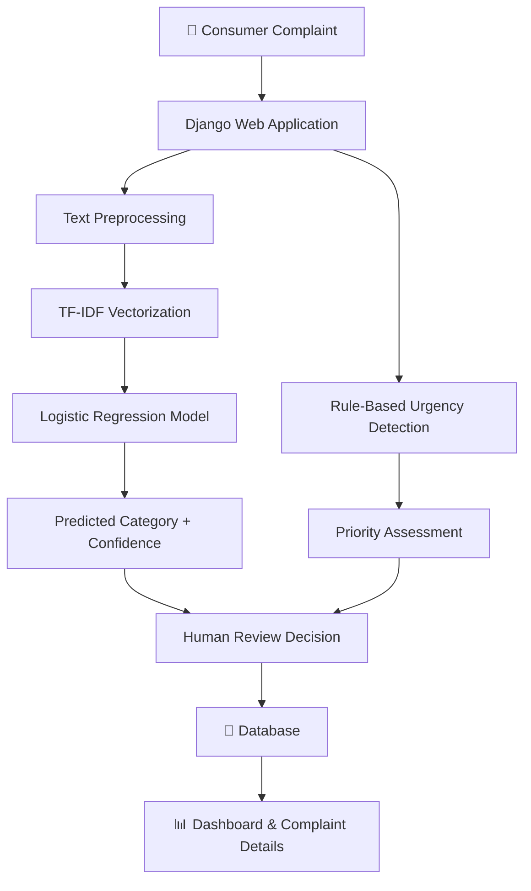

# 🔍 ResolveIQ

### INTELLIGENT COMPLAINT ANALYSIS & PRIORITIZATION

<p align="center">
  
  
  
  
</p>

<p align="center">
  <b>Turning consumer complaints into actionable insights.</b>
</p>

---

## 🌟 Overview

**ResolveIQ** is an AI-powered consumer complaint intelligence platform designed to automate complaint classification, identify urgency, and support efficient complaint management.

It combines Natural Language Processing (NLP), Machine Learning, and Django to transform unstructured consumer complaints into structured, actionable information.

Instead of manually reviewing every complaint, ResolveIQ predicts its category, evaluates urgency, and flags uncertain predictions for human review.

## ✨ Key Features

| Feature | Description |
|---|---|
| 🤖 AI Complaint Classification | Automatically predicts complaint categories using a trained ML model. |
| 🧠 NLP Processing | Processes and cleans complaint text before classification. |
| 🚨 Urgency Detection | Identifies urgency through transparent keyword and phrase matching. |
| 🎯 Confidence Scoring | Displays the model's prediction probability. |
| 👨‍💻 Human-in-the-Loop | Flags low-confidence predictions for manual review. |
| 📊 Dashboard | Provides an overview of complaints and their distribution. |
| 🗂️ Complaint Management | Submit, store, and inspect individual complaints. |

## 🏗️ System Architecture



## 🧠 Machine Learning Model

ResolveIQ uses a supervised machine learning pipeline for multi-class complaint classification.

**Model pipeline:**

- Text preprocessing
- TF-IDF vectorization
- Logistic Regression classifier
- Probability-based confidence scoring

**Classification categories:**

- Bank account services
- Credit card
- Credit reporting
- Debt collection
- Money transfers
- Mortgages and loans

**Model evaluation**

| Model | Validation Macro F1 |
|---|---:|
| Logistic Regression | 0.7932 |
| Linear SVM | 0.7820 |
| Naive Bayes | 0.7706 |

Logistic Regression was selected based on its validation performance.

> Note: These are validation results, not final test-set performance. Confidence scores are model probabilities and should not be interpreted as calibrated certainty.

## ⚙️ Technology Stack

| Layer | Technologies |
|---|---|
| Backend | Python, Django |
| Machine Learning | Scikit-learn, TF-IDF, Logistic Regression |
| NLP | Text preprocessing, feature extraction |
| Model Storage | Joblib |
| Database | SQLite |
| Frontend | HTML, CSS, JavaScript |
| Version Control | Git, GitHub |

## 📁 Project Structure

```text
resolveiq/
│
├── complaints/
│   ├── services/
│   │   ├── analysis.py
│   │   ├── classifier.py
│   │   └── urgency.py
│   ├── admin.py
│   ├── forms.py
│   ├── models.py
│   ├── urls.py
│   └── views.py
│
├── config/
│   ├── settings.py
│   ├── urls.py
│   ├── asgi.py
│   └── wsgi.py
│
├── data/
│
├── ml_artifacts/
│   ├── complaint_pipeline.joblib
│   └── model_metadata.json
│
├── static/
├── templates/
├── manage.py
├── requirements.txt
└── README.md
```

## 🚀 Getting Started

### 1. Clone the repository

```bash
git clone https://github.com/YOUR_USERNAME/resolveiq.git
cd resolveiq
```

### 2. Create a virtual environment

```bash
python -m venv .venv
```

Activate it:

**Windows:**
```powershell
.venv\Scripts\activate
```

**Linux / macOS:**
```bash
source .venv/bin/activate
```

### 3. Install dependencies

```bash
pip install -r requirements.txt
```

### 4. Apply database migrations

```bash
python manage.py migrate
```

### 5. Start the development server

```bash
python manage.py runserver
```

Open your browser:

```text
http://127.0.0.1:8000/
```

## 🔄 How It Works

1. A consumer submits a complaint through the Django interface.
2. The complaint text is cleaned and preprocessed.
3. The trained ML pipeline predicts the complaint category.
4. A confidence score is generated for the prediction.
5. Rule-based urgency detection evaluates the complaint.
6. Low-confidence predictions are flagged for human review.
7. The complaint and analysis results are stored in the database.


## 🎯 Project Objective

The goal of ResolveIQ is to explore how machine learning and NLP can improve consumer complaint management through automated classification, transparent urgency detection, and human-in-the-loop decision-making.

## 👩‍💻 Author

**Sakshi Patil**

B.Tech – Computer Science & Engineering (AI & ML)

[](https://github.com/sakshipatil-hue)

---

<p align="center">
  <b>Built with Python, Machine Learning, and a focus on solving real-world problems. 🚀</b>
</p>
